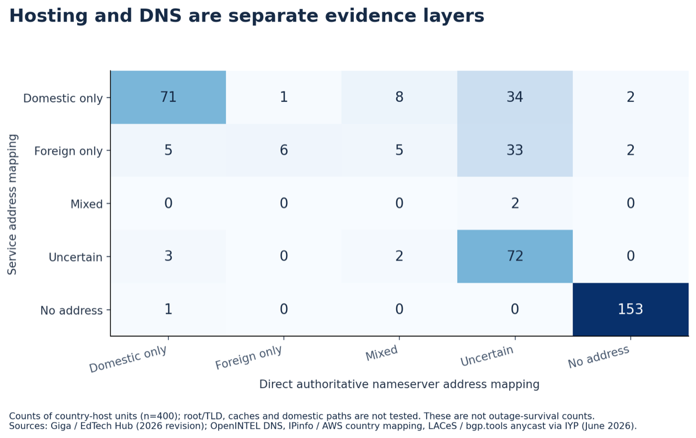

# How countries rely on other countries’ Internet (educational websites)

Could students still reach their learning platforms if their country lost international connectivity? We traced the infrastructure behind 400 country–hostname pairs in a national education platform inventory. For Austria’s digital library, digi4school.at, the observed website addresses mapped to Austria, while its authoritative DNS server addresses mapped to Germany.

## What we did

We grouped entries from the Giga / EdTech Hub inventory by country and hostname so that several education pages on one government portal counted once. Using the Internet Yellow Pages (IYP) and the linked Cypher queries, we joined hostnames to website and nameserver addresses. OpenINTEL supplied DNS relationships. IPinfo and AWS supplied location evidence, and bgp.tools and LACeS supplied anycast evidence. We retained uncertain locations and missing addresses in the results.

## What we found

Of the 400 pairs, 116 had website addresses that mapped exclusively to the service country. Within those 116, observed authoritative DNS addresses mapped domestically for 71, abroad for one, and both domestically and abroad for eight. For the remaining 36, the evidence was uncertain or missing.

We also checked existing OONI Web Connectivity observations for 30 selected country–hostname pairs. Four had observations for the same hostname. None matched the exact education URL in the inventory.

## Status and next steps

The analysis of existing measurements is complete. Whether a student can still use a platform during an outage remains open. A follow-up could test whether domestic resolvers can refresh expired DNS records and whether students can complete a learning activity from different domestic networks.

[Presentation and dataset credits (PDF)](presentation.pdf) · [IYP queries](queries/) · [IYP paper](https://doi.org/10.1145/3646547.3688444) · [IYP repository and dataset credits](https://github.com/InternetHealthReport/internet-yellow-pages/blob/main/ACKNOWLEDGMENTS.md)

The research leading to these results was made possible by OpenINTEL (https://www.openintel.nl/), a joint project of the University of Twente, SIDN, NLnet Labs and SURF.

Project idea from ISOC Pulse. Project contributor: Zuyao Xu, Nankai University ([@TochusC](https://github.com/TochusC)).
